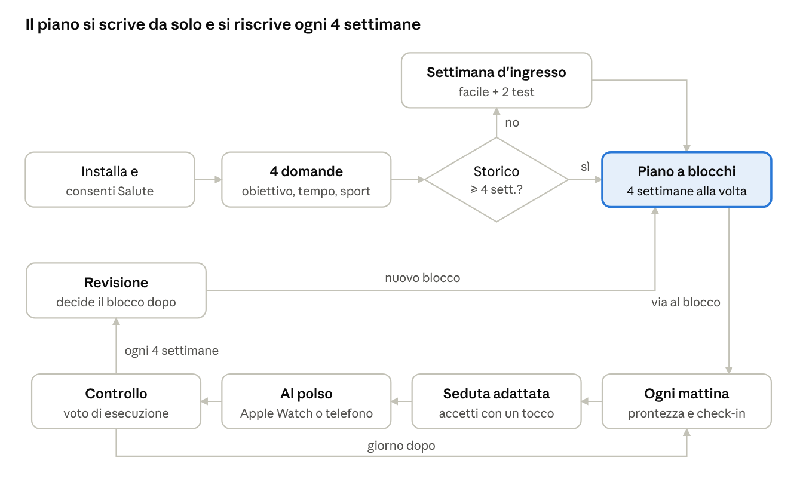
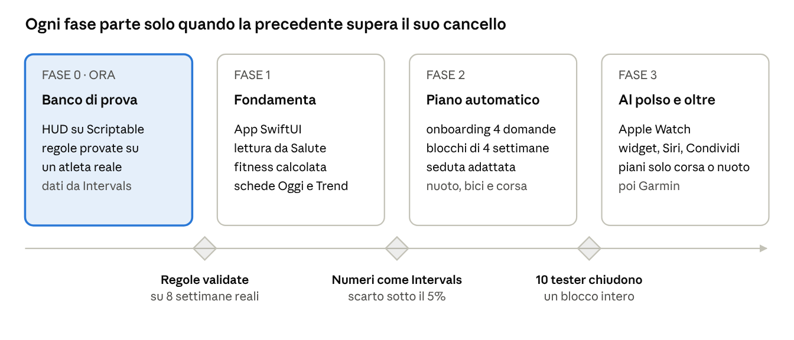

# Specifica di prodotto · App di allenamento

Ottobre 2026

## Visione e posizionamento

Un'app iOS che ogni mattina dice all'atleta di endurance cosa fare oggi e perché, e costruisce da sola il piano: l'utente non scrive mai un allenamento.

Il problema: chi si allena per una gara oggi deve scegliere fra piani generici da scaricare, piattaforme complesse (Intervals, TrainingPeaks) o un coach a pagamento. I wearable misurano molto ma non decidono nulla.

| App | Cosa fa bene | Cosa le manca |
| --- | --- | --- |
| Strava | Diario sociale delle attività | Nessun piano, nessuna lettura del recupero |
| Whoop | Punteggio di recupero e sforzo | Dà un numero, non adatta la seduta |
| Garmin Connect | Metriche dall'orologio | Molti dati, poche decisioni, piani rigidi |
| TrainingPeaks / Intervals | Pianificazione potente | Richiede di costruire tutto a mano |

**Il posizionamento:** il piano si scrive da solo e si riscrive ogni 4 settimane; la seduta di oggi si adatta a come stai, con due orologi separati per cuore e tessuti.

**Per chi:** atleti amatori di corsa, triathlon e nuoto con un obiettivo (una gara o un miglioramento), un orologio qualsiasi e poco tempo per pianificare.

## Principi di prodotto

Sei regole che decidono ogni scelta di design; quando due funzioni sono in conflitto, vince la regola più in alto.

1. **Decide, non mostra.** Ogni schermata risponde a una domanda: cosa faccio oggi, come sto andando, cosa mangio. I numeri spiegano la decisione, non la sostituiscono.
2. **Zero costruzione.** L'utente risponde a 4 domande e non scrive mai una seduta. Può spostare o saltare, mai progettare.
3. **Nessuna piattaforma esterna obbligatoria.** I dati arrivano da Apple Salute; Intervals, Garmin e Strava sono collegamenti facoltativi.
4. **Onestà sui dati.** Se l'orologio non è stato indossato o mancano notti, l'app lo dice e diventa più prudente, non finge certezza.
5. **Tono calmo.** Niente serie da non interrompere, niente medaglie, niente sensi di colpa. Notifiche solo quando c'è qualcosa da fare.
6. **Personale nel tempo.** Le soglie generiche diventano soglie dell'utente man mano che l'app impara quali segnali predicono le sue sedute.

## Percorso dell'utente

Dall'installazione al primo blocco servono 4 domande; da lì il ciclo quotidiano e la revisione ogni 4 settimane girano da soli.

Chi ha meno di 4 settimane di storico passa da una settimana d'ingresso con due test; tutti gli altri ricevono subito il primo blocco.

## Onboarding

In meno di 2 minuti: un permesso, quattro domande, e il livello letto dallo storico invece che chiesto.

| Passo | Cosa chiede | Come risponde l'utente |
| --- | --- | --- |
| 1. Permesso Salute | Lettura di allenamenti, FC, HRV, sonno, peso | Un tocco su "Consenti" |
| 2. Obiettivo | Gara con distanza e data, oppure "migliorare" o "stare in forma" | Scelta da elenco + data |
| 3. Disponibilità | Giorni a settimana, ore massime, giorno del lungo | Griglia settimanale con mattina, pranzo, sera |
| 4. Sport possibili | Piscina, bici (anche solo indoor), palestra | Interruttori |
| 5. Orologio | Apple Watch, Garmin, altro | Scelta da elenco |

**Livello letto, non chiesto.** L'app analizza 3–6 mesi di storico in Salute: volume settimanale per sport, seduta più lunga recente, fitness stimata, FC a riposo e HRV di base. Le zone partono da formule standard e si correggono con le prime sedute.

**Senza storico.** Chi ha meno di 4 settimane di dati riceve una settimana di ingresso con sedute facili e due test brevi (corsa a gradini, 400+200 in piscina) per fissare le zone.

## Fonti dati

Apple Salute è l'unica fonte obbligatoria: ci scrivono Apple Watch, Garmin, Coros, Polar, Suunto, Whoop e Oura, quindi l'app funziona con quasi ogni orologio.

| Dato | Da dove | Uso nell'app |
| --- | --- | --- |
| Allenamenti con FC, passo, distanza, dislivello | Salute | Carico, esecuzione, durabilità, impatto corsa |
| HRV notturna e FC a riposo | Salute | Semaforo sistemico, predittori |
| Sonno (durata, fasi) | Salute | Semaforo sistemico, scheda Sonno |
| Peso | Salute (bilance collegate) | Carburante adattivo |
| Check-in mattutino | App | Predittori personali |

**Calcoli interni.** Fitness, fatica e forma (CTL, ATL, TSB) si calcolano nell'app dal carico di ogni seduta, stimato dalla FC (TRIMP) quando mancano potenza o passo di riferimento. Non serve alcun server.

**Collegamenti facoltativi.** Intervals.icu e TrainingPeaks per chi già pianifica lì; Strava solo per pubblicare. Nessuna funzione centrale dipende da loro.

## Generatore del piano

Il piano si genera a blocchi di 4 settimane: tre di carico e una di scarico. Ogni blocco nasce dalla revisione del precedente, quindi il piano non diventa mai vecchio.

**Periodizzazione all'indietro dalla gara.**

| Fase | Quando | Obiettivo | Qualità |
| --- | --- | --- | --- |
| Base | Fino a \~16 settimane dalla gara | Volume aerobico, tecnica, forza | 1 seduta a settimana, brevi variazioni |
| Costruzione | 16–6 settimane prima | Soglia e ritmo gara | 2 sedute a settimana |
| Picco | 6–2 settimane prima | Specificità, lunghi al ritmo gara | 2 sedute, volume stabile |
| Scarico | Ultime 2 settimane | Freschezza | Volume −40–60%, brevi richiami |

Senza gara l'app alterna blocchi di base e costruzione per sempre.

**Regole di carico.**

- Ore settimanali di partenza = media delle ultime 4 settimane, mai oltre la disponibilità dichiarata.
- Crescita della fitness tra 3 e 6 punti a settimana; oltre 7 il blocco si ricalcola.
- Circa 80% del tempo facile, 20% di qualità.
- Lungo di corsa +10' ogni due settimane, mai oltre il 40% del tempo settimanale di corsa (calibrato con i test: il 30% era irrealistico con 3 uscite).
- Mai due giorni di qualità di fila nello stesso sport; mai forza pesante per le gambe il giorno prima o dopo la qualità di corsa.
- Ripartizione per sport dal tipo di obiettivo (es. 70.3: circa 20% nuoto, 45% bici, 35% corsa).

**Libreria di sedute.** Ogni seduta è un modello con parametri (durata, ripetute, intensità in % della soglia) che si traduce in passi e battiti personali. Esempi: soglia 6×5', VO2 5×3', lungo progressivo, nuoto ritmo 8×200. L'utente non vede mai il modello, solo la seduta pronta.

**Piano vivo.** A fine blocco la revisione decide il successivo: aderenza sotto il 70% ripete il carico; segnali di affaticamento o impatto della corsa sopra 1,3 anticipano lo scarico; altrimenti +5–8%.

## Motore di decisione quotidiana

Ogni mattina l'app combina due semafori e propone la seduta di oggi già adattata; l'utente accetta con un tocco.

| Segnale | Regole (soglie iniziali, poi personali) | Effetto |
| --- | --- | --- |
| Sistemico | HRV sotto media 7 gg − 1 dev. std; FC riposo +5 (giallo) o +8 (rosso); sonno sotto 60 o meno di 6 h; forma sotto −30 | Qualità → Z2 al 70% del tempo; lungo −20% tutto Z2 |
| Tessuti | Corsa con 400 m D+ o più, o carico oltre 150% del previsto, nelle ultime 72 h | Qualità di corsa → bici o nuoto facile; lungo −30% in piano |
| Affaticamento periferico | Due qualità di fila con FC massima sotto soglia e passo a parità di FC peggiore del 3% | 3–4 giorni solo Z2, qualità all'aperto alla ripresa |
| Dati mancanti | Notte senza HRV o sonno | Affidabilità bassa dichiarata, nessuna intensità proposta in automatico |

**Spostamento della qualità.** Una seduta dura saltata va al primo giorno libero della settimana, a 48 h dai tessuti in recupero; se non c'è, salta e la settimana dopo resta invariata.

**Controllo dopo la seduta.** Voto di esecuzione 0–100 da durata e carico rispetto al previsto, più avvisi specifici (FC soppressa, passo peggiore, seduta accorciata, qualità su tapis).

**Predittori personali.** L'app confronta HRV, FC a riposo, sonno e check-in (gambe, energia, umore) con il passo a parità di battiti delle corse all'aperto. Dopo 12 corse abbinate mostra quali segnali contano per quell'utente e sposta le soglie di conseguenza.

## Schermate

Quattro schede e un pulsante Condividi, già validate nel prototipo Scriptable; nella versione nativa cambia solo da dove arrivano i dati.

| Scheda | Domanda a cui risponde | Contenuto |
| --- | --- | --- |
| Oggi | Come sto? | Prontezza con verdetto, check-in, forma, sonno, cuore e corpo, predittori, avvisi |
| Settimana | Cosa faccio e come è andata? | Proposta adattata, calendario del blocco con sedute passo per passo, impatto della corsa, voto di esecuzione, revisione |
| Carburante | Cosa mangio oggi? | Kcal e macro dal carico del giorno, pasti, peso e ritmo di calo con avviso se mangi poco per il carico |
| Trend | Sto andando nella direzione giusta? | Grafico fitness, traiettoria verso l'obiettivo, durabilità (passo a parità di FC) |
| Condividi | Come lo racconto? | PNG trasparenti in 6 layout e 5 stili, copia per le storie |

**Fuori dall'app.** Widget nella Home e nella schermata di blocco con la parola del giorno e la seduta; comando Siri "Come sto?"; notifiche solo per ricarica della sera prima di un lungo e affaticamento.

## Esecuzione al polso

La seduta del giorno deve arrivare all'orologio senza che l'utente la ricopi; il modo dipende dall'orologio.

| Orologio | Come arriva la seduta | Stato |
| --- | --- | --- |
| Apple Watch | WorkoutKit: seduta strutturata (riscaldamento, ripetute, recuperi, target) inviata all'app Allenamento | Disponibile per app native, iOS 17 e successivi |
| Garmin | Garmin Training API: sedute inviate al calendario Garmin e sincronizzate sull'orologio | Richiede l'adesione al programma sviluppatori Garmin; da verificare tempi e requisiti |
| Coros, Polar, Suunto | Integrazioni partner, una per marchio | Fase successiva |
| Altri | Seduta sul telefono e sulla schermata di blocco, con passi e battiti personali | Sempre disponibile |

Dopo la seduta i dati tornano in Salute da soli, e l'app chiude il cerchio con il controllo di esecuzione.

## Privacy, sicurezza e responsabilità

I dati di salute restano sul telefono: tutti i calcoli avvengono in locale e nulla parte senza un'azione esplicita dell'utente.

- **Dati in locale.** Nessun server proprio nella prima versione; il backup passa da iCloud dell'utente. Le immagini condivise non contengono mappe GPS.
- **Prudenza di default.** Con dati scarsi, storico breve o segnali contrastanti l'app riduce il carico, non lo aumenta.
- **Non è un dispositivo medico.** Avviso chiaro nell'onboarding; con FC a riposo molto alta per più giorni o sintomi segnalati, l'app suggerisce di sentire un medico invece di adattare la seduta.
- **Infortuni.** Interruttore "ho un dolore" che sospende la corsa e propone sport alternativi fino al via libera dell'utente.

## Roadmap e metriche di successo

Quattro fasi, ciascuna con un cancello misurabile: si passa alla successiva solo quando il cancello è superato.

**Metriche dopo il lancio.**

- Attivazione: utenti che completano l'onboarding e la prima settimana.
- Aderenza: sedute svolte su sedute proposte, obiettivo sopra il 75%.
- Fiducia: proposte adattate accettate su proposte mostrate.
- Ritenzione: utenti attivi dopo 3 blocchi (12 settimane).
- Esito: obiettivi raggiunti e infortuni segnalati, i secondi in calo blocco dopo blocco.

## Domande aperte

- [ ] Sport della prima versione: deciso, triathlon (nuoto, bici, corsa) fin dal lancio.
- [ ] Modello di business: deciso, abbonamento. Da definire prezzo, durata della prova e cosa resta gratuito.
- [ ] Chi valida le regole del generatore: un allenatore certificato da coinvolgere come consulente?
- [ ] Nome del prodotto: "HUD 70.3" è legato a una distanza, serve un nome generico.
- [ ] Garmin Training API: verificare requisiti e tempi di approvazione prima di promettere l'invio al polso.
- [ ] Lingue al lancio: solo italiano o italiano e inglese?
